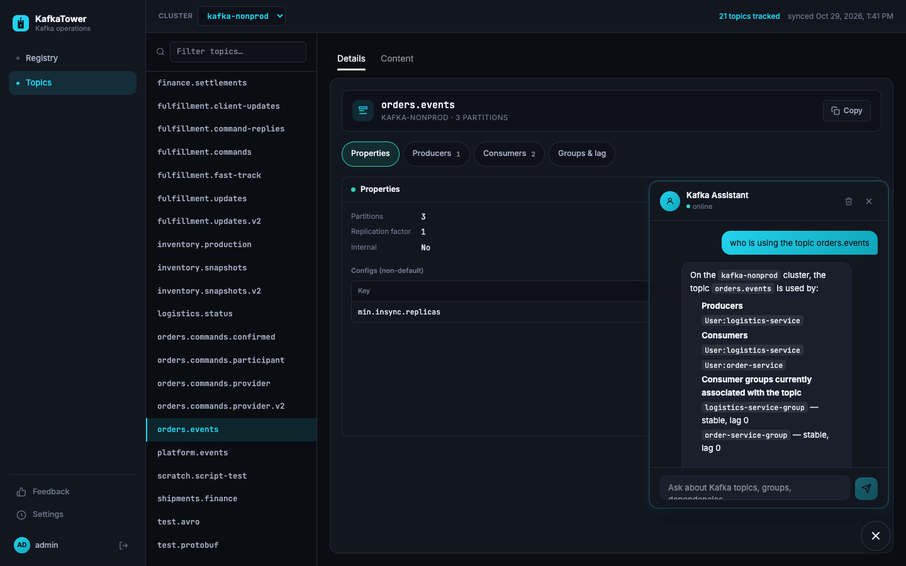
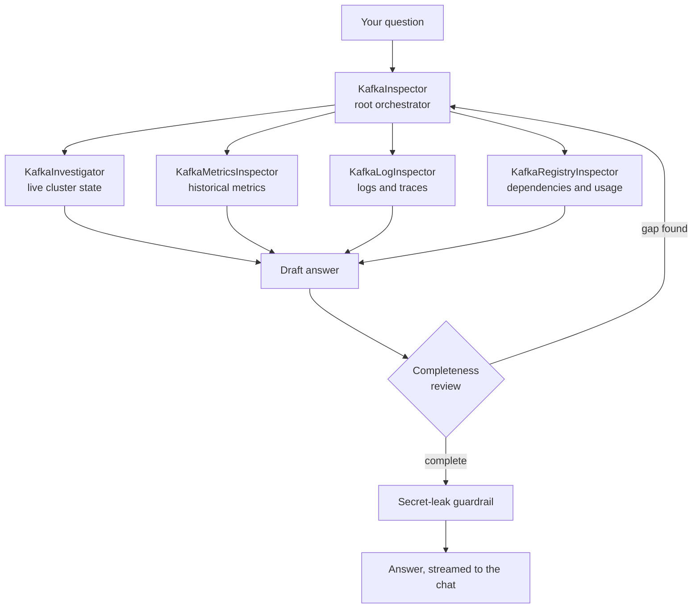
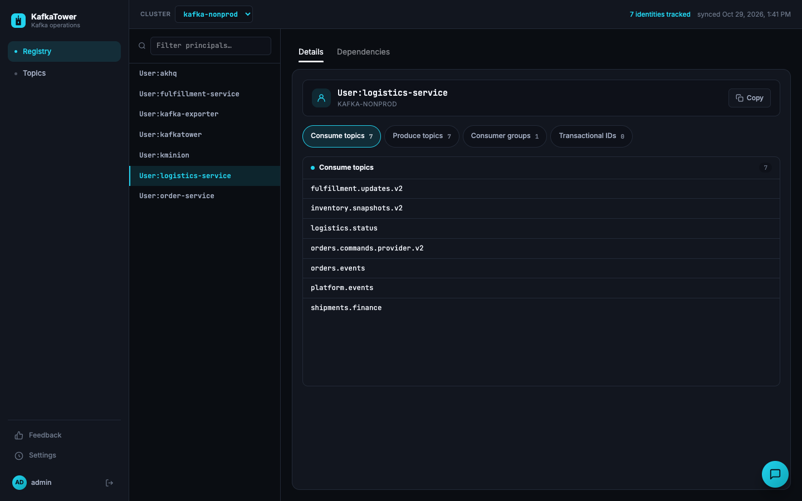
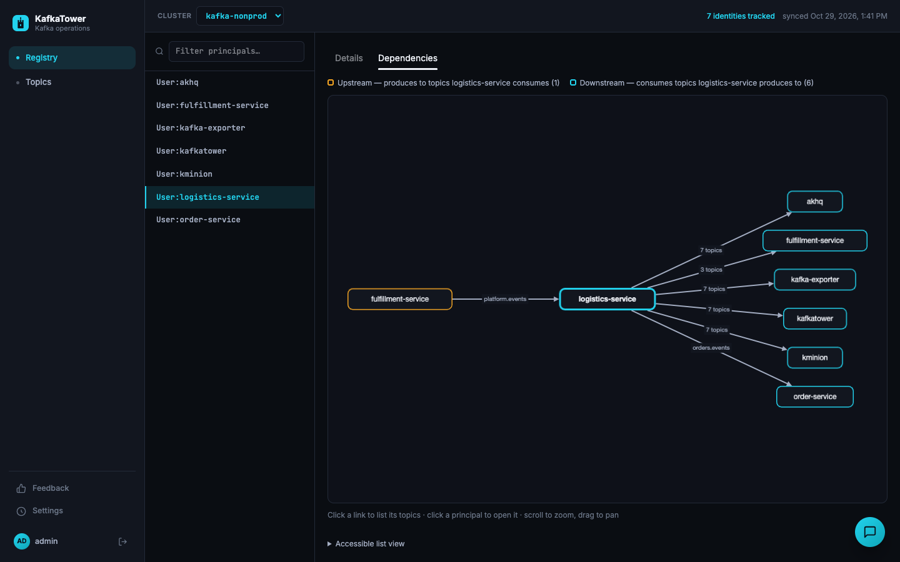
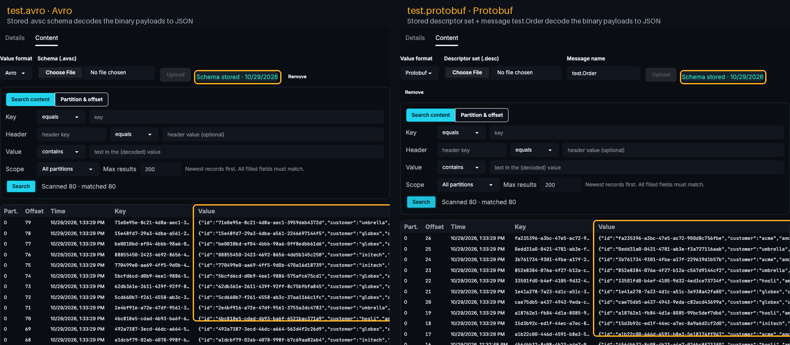

<div align="center">

# KafkaTower

**One calm console for everything happening on your Kafka clusters, with an AI assistant that investigates for you.**

See who can touch what, which topics are alive and whether your consumers keep up. Or just ask: a team of specialist agents queries live cluster state, historical metrics and logs, then cross-checks its own answer before replying.



</div>

---

## The assistant: an agent team, not a chatbot

Ask a question in plain language ("why is `orders-consumer` lagging since 14:00?"). A root agent decides which specialists to consult, in any order, chaining their findings when a question needs it. For example, it narrows a timeframe with metrics, then searches the logs inside that window.



Built on [Embabel](https://github.com/embabel/embabel-agent): each agent declares goals and actions, and its behaviour is steered by markdown "skills" in `src/main/resources/skills/`.

### The specialists and their tools

| Agent | Looks at | Tools |
|-------|----------|-------|
| **KafkaInvestigator** | Live cluster state | 17 Kafka AdminClient tools: brokers, cluster, topics and configs, partition offsets, consumer groups and lag, ACLs per principal or topic, client quotas |
| **KafkaMetricsInspector** | Historical time series from any Prometheus-compatible store ([VictoriaMetrics](https://victoriametrics.com/), [Prometheus](https://prometheus.io/), Thanos, Mimir) | `metrics`, `query`, `query_range`, `labels`, `label_values` over the PromQL HTTP API, plus a metrics catalog (Kafka core and extended, KMinion) and playbooks for brokers, topics, consumer groups, principals, cluster health and known failure patterns |
| **KafkaLogInspector** | Logs and traces ([OpenSearch](https://opensearch.org/)) | `search_documents`, `aggregate_documents`, `get_document` |
| **KafkaRegistryInspector** | Dependencies and usage from the registry (in-memory topic and ACL graphs per cluster) | `findTopics`, `whoUsesTopic`, `topicConsumerGroups` (live lag), `findPrincipals`, `describePrincipal`, `principalDependencies`: who produces to or consumes from a topic, what a service can access, and what depends on what through shared topics. ACL-based, so it reports what is permitted, not observed traffic |

All tools are read-only. Live-state results are cached for 15–30 s so a multi-step investigation doesn't hammer the brokers.

### Built to be trusted

- **Independent completeness review:** every draft is checked for gaps and refined with further tool calls, for at most 2 rounds (`agent.orchestration.max-rounds`).
- **Secret-leak guardrail:** answers containing bearer tokens, API keys, passwords or PEM private keys are rejected.
- **Untrusted tool output:** specialists are instructed to treat data returned by tools (log lines, configs) as data, never as instructions.
- **Auditable:** each tool call and LLM call is logged with timing, slow calls are flagged, and traces go to an OpenTelemetry collector (viewable in Phoenix).
- **Live progress:** the chat streams the agent's phases and tokens as it works.

---

## The console

### Registry: who can do what

The registry is built from the cluster's ACLs, so it shows what each application identity is *allowed* to do. Pick one (here `User:logistics-service`) and you get two views.

**Details** lists what the identity consumes and produces, the consumer groups it owns and the transactional IDs it holds. Literal and prefixed grants are labelled, with live group state next to them.



**Dependencies** draws the identity's relationships as a graph. An **upstream** principal (amber) produces to a topic this identity consumes. **Downstream** principals (cyan) consume a topic it produces to. Each link is labelled with the shared topic, or with a topic count when there are several. Here `fulfillment-service` feeds `logistics-service` through `platform.events`, and six principals read what `logistics-service` writes. Click a link to list its topics, click a principal to open it, scroll to zoom and drag to pan. An accessible list view carries the same data.



The graph comes from grants, not from observed traffic, so it answers "who may depend on whom". The assistant uses the same data for questions like "who is using the topic `orders.events`".

### Topics: what exists and who uses it

Browse every topic with its properties, producers and consumers, check consumer-group **lag**, and (as an admin) search the **content** of a topic live. JSON, Avro and protobuf payloads are decoded and streamed back as they match.


#### Avro and protobuf: decoded with the stored schema

Avro and protobuf records are binary on the wire, so the **Content** tab needs the schema to read them. Upload it once per topic and cluster: an `.avsc` file for Avro, or a protobuf descriptor set (`.desc`) plus the message name, such as `test.Order`. KafkaTower validates the schema on upload, keeps it in its own database, and uses it to decode every record it scans. A record that doesn't match the schema, or a topic with no schema, is shown as plain text and marked as not decoded.

The screenshot shows `test.avro` and `test.protobuf` side by side. Both hold the same `Order` payload as raw bytes; the highlighted **Schema stored** badge is the stored schema turning those bytes into the JSON in the **Value** column. Confluent-framed Avro (magic byte plus schema id) also works, with no schema registry involved.



To try it, `scripts/produce-test-messages.py` writes random `Order` messages to an existing topic and needs only Python 3 (no packages). It connects to `localhost:9092` as `admin` by default; override with `KAFKA_BOOTSTRAP_SERVERS`, `KAFKA_USERNAME`, `KAFKA_PASSWORD`.

```bash
./scripts/produce-test-messages.py avro     -n 100 -t test.avro
./scripts/produce-test-messages.py protobuf -n 100 -t test.protobuf
```

Then upload `scripts/schemas/avro-order.avsc` (Avro) or `scripts/schemas/order.desc` with message name `test.Order` (protobuf) on the topic's **Content** tab.

### And also

- **Multiple clusters:** switch between them from the header.
- **Sign-in with roles:** content search is restricted to admins.

---

## Architecture

A Maven reactor of six modules; the app wires the specialists in, and each one contributes its own tools, skills and frontend tab.

| Module | Role |
|--------|------|
| `kafkatower-app` | Spring Boot app, root agent, chat API, serves the frontend |
| `kafkatower-common` | Security, shared agent plumbing: audit, guardrails, streaming, the `MetricsBackend` PromQL client |
| `kafkatower-kafka` | `KafkaInvestigator` and the AdminClient tools |
| `kafkatower-metrics` | `KafkaMetricsInspector`, metrics catalog and playbooks |
| `kafkatower-log` | `KafkaLogInspector` and the OpenSearch tools |
| `kafkatower-registry` | ACL registry, dependency graph, topic content search (Flyway-managed DB) |

The frontend is Svelte (`frontend/`), split into a core and one module per specialist.

---

## Getting started

### Prerequisites

- Java 21
- Maven 3.9+ (Node is downloaded automatically during the build)
- Docker, for the local demo environment
- A Prometheus-compatible metrics store for the metrics specialist (VictoriaMetrics in the demo; set its URL under *Settings → Metrics*)
- PostgreSQL for KafkaTower's own data (the `postgres` service in `compose.yml` matches the defaults), or the `h2` profile for a single-node setup with no database server
- An LLM endpoint for the assistant (OpenAI-compatible: API key, base URL and model). It is configured in the UI, see step 5

### 1. Start the demo environment (optional)

`compose.yml` brings up PostgreSQL, Kafka with demo applications, AKHQ, VictoriaMetrics, OpenSearch with Fluent Bit, an OpenTelemetry collector and Phoenix, so every specialist has something to query:

```bash
docker compose up -d
```

Prefer Prometheus to VictoriaMetrics? `docker compose --profile prometheus up -d prometheus`, then point the app at `http://localhost:9090` under *Settings → Metrics* (see step 5), or start it with `AGENT_METRICS_URL=http://localhost:9090`.

### 2. Build

```bash
./build.sh
```

`build.sh` is a thin wrapper around `mvn clean package` that uses a project-local Maven repository. You can run plain `mvn clean package` instead.

### 3. Run

```bash
java -jar backend/kafkatower-app/target/kafkatower-backend-1.0.0.jar
```

Without PostgreSQL, run the file-based H2 database next to the jar instead:

```bash
java -jar backend/kafkatower-app/target/kafkatower-backend-1.0.0.jar --spring.profiles.active=h2
```

The database connection can be overridden with `DB_URL`, `DB_USER` and `DB_PASSWORD`.

### 4. Open

Go to **http://localhost:8089** and sign in.

| Username | Password   | Role  |
|----------|------------|-------|
| `admin`  | `admin123` | Admin |
| `user`   | `user123`  | User  |

These are development defaults. Change them before exposing the app to anyone.

### 5. Configure from the Settings panel

Admins configure the Kafka clusters and the integrations from **Settings** (bottom of the sidebar), with no file edits or restarts of the process. Each tab has its own **Verify & save** button: the backend first tests the new values against the real service, and saves them only if the test passes. A rejected save stores nothing and shows the reason in the panel.

| Tab | What you set | What the check does |
|-----|--------------|---------------------|
| **LLM** | API key, base URL, model | Lists the endpoint's `/models` and checks the key is accepted and the model is served (endpoints without `/models` get a one-token test request) |
| **Kafka** | One entry per cluster: name, bootstrap servers and the security type: **None**, **mTLS** (keystore, truststore, passwords) or **SASL** (PLAIN, SCRAM-SHA-256 or SCRAM-SHA-512, optionally over TLS) | Connects to the brokers with these settings and asks for the cluster nodes. It reports missing certificate files, TLS or authentication failures, and a wrong security type for the listener |
| **OpenSearch** | Enable toggle, one connection per Kafka cluster (name, URL, index or pattern, user, password), default cluster | Calls `_cluster/health` on every cluster, then `<index>/_count` for its index. Skipped while the toggle is off |
| **Metrics** | Prometheus-compatible URL (VictoriaMetrics, Prometheus, Thanos, Mimir), bearer token or basic auth, tenant | Queries `/api/v1/labels` with the given credentials |

Saving a change applies it right away: the application restarts its Spring context (a few seconds, you sign in again). Saving identical values only re-verifies them and does not restart.

---

## License

KafkaTower is free to use, modify and redistribute, including commercially, under the [Apache License 2.0](LICENSE).

If you reuse the code, credit the original project: keep the [LICENSE](LICENSE) and the [NOTICE](NOTICE) file (or its attribution text) with your copy, and mark any files you changed. A link back to [github.com/mdkouki/KafkaTower](https://github.com/mdkouki/KafkaTower) is appreciated.
