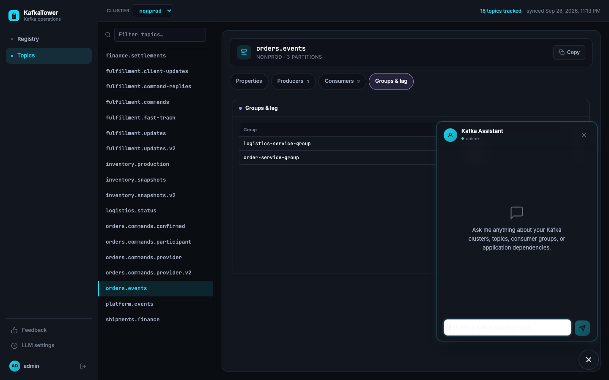
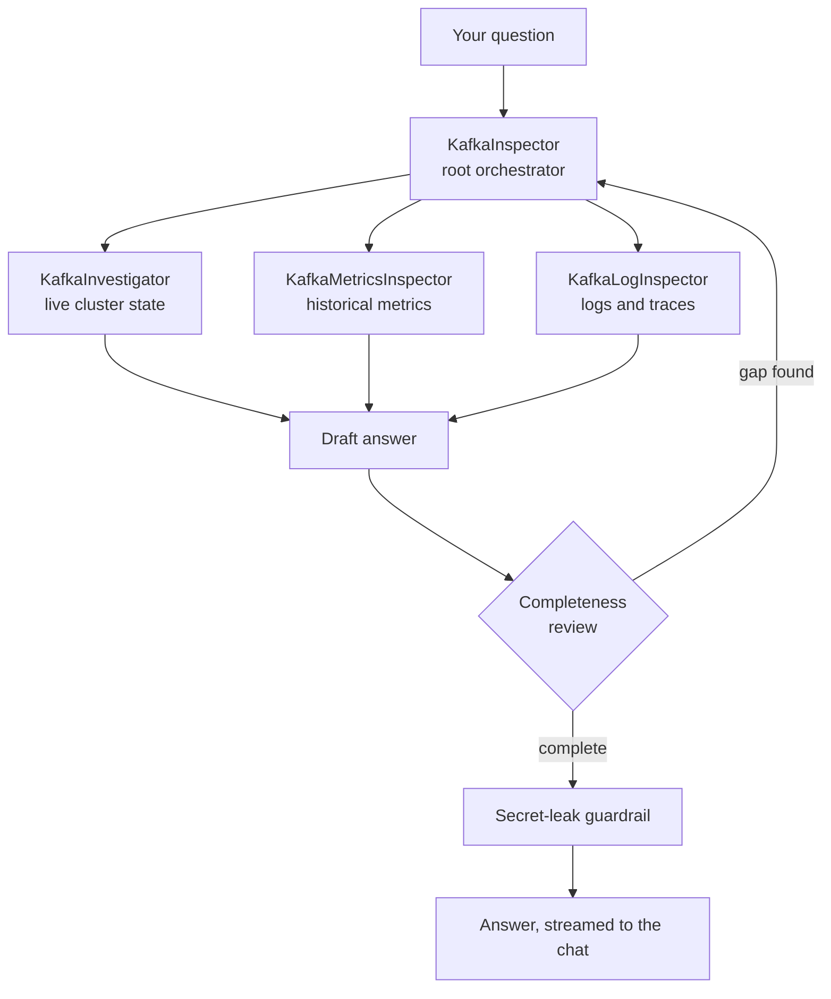
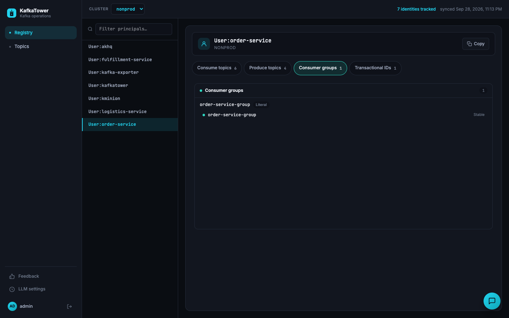
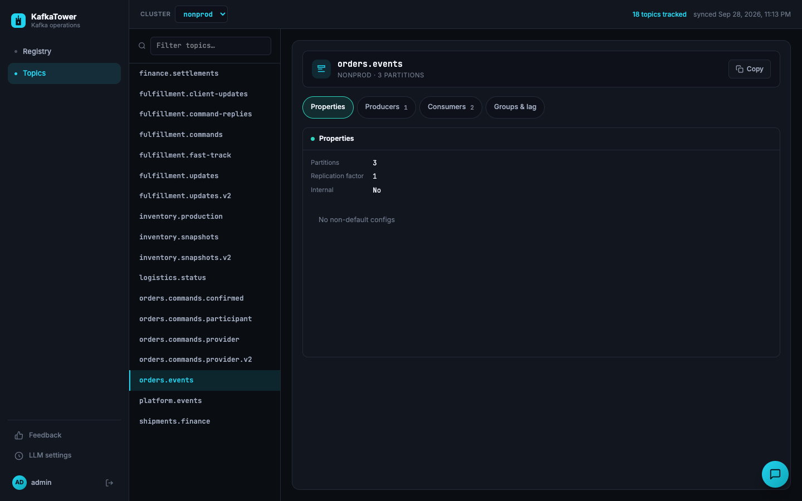

<div align="center">

# KafkaTower

**One calm console for everything happening on your Kafka clusters, with an AI assistant that investigates for you.**

See who can touch what, which topics are alive and whether your consumers keep up. Or just ask: a team of specialist agents queries live cluster state, historical metrics and logs, then cross-checks its own answer before replying.



</div>

---

## The assistant: an agent team, not a chatbot

Ask a question in plain language ("why is `orders-consumer` lagging since 14:00?"). A root agent decides which specialists to consult, in any order, chaining their findings when a question needs it. For example, it narrows a timeframe with metrics, then searches the logs inside that window.



Built on [Embabel](https://github.com/embabel/embabel-agent): each agent declares goals and actions, and its behaviour is steered by markdown "skills" in `src/main/resources/skills/`.

### The specialists and their tools

| Agent | Looks at | Tools |
|-------|----------|-------|
| **KafkaInvestigator** | Live cluster state | 17 Kafka AdminClient tools: brokers, cluster, topics and configs, partition offsets, consumer groups and lag, ACLs per principal or topic, client quotas |
| **KafkaMetricsInspector** | Historical time series from any Prometheus-compatible store ([VictoriaMetrics](https://victoriametrics.com/), [Prometheus](https://prometheus.io/), Thanos, Mimir) | `metrics`, `query`, `query_range`, `labels`, `label_values` over the PromQL HTTP API, plus a metrics catalog (Kafka core and extended, KMinion) and playbooks for brokers, topics, consumer groups, principals, cluster health and known failure patterns |
| **KafkaLogInspector** | Logs and traces ([OpenSearch](https://opensearch.org/)) | `search_documents`, `aggregate_documents`, `get_document` |

All tools are read-only. Live-state results are cached for 15–30 s so a multi-step investigation doesn't hammer the brokers.

### Built to be trusted

- **Independent completeness review:** every draft is checked for gaps and refined with further tool calls, for at most 2 rounds (`agent.orchestration.max-rounds`).
- **Secret-leak guardrail:** answers containing bearer tokens, API keys, passwords or PEM private keys are rejected.
- **Untrusted tool output:** specialists are instructed to treat data returned by tools (log lines, configs) as data, never as instructions.
- **Auditable:** each tool call and LLM call is logged with timing, slow calls are flagged, and traces go to an OpenTelemetry collector (viewable in Phoenix).
- **Live progress:** the chat streams the agent's phases and tokens as it works.

---

## The console

### Registry: who can do what

Pick any application identity and see which topics it consumes and produces, the consumer groups it owns and the transactional IDs it holds. Literal and prefixed grants are labelled, with live group state next to them. A **Dependencies** tab draws the principal's relationships as a graph.



### Topics: what exists and who uses it

Browse every topic with its properties, producers and consumers, check consumer-group **lag**, and (as an admin) search the **content** of a topic live. JSON, Avro and protobuf payloads are decoded and streamed back as they match.



### And also

- **Multiple clusters:** switch between them from the header.
- **Sign-in with roles:** content search is restricted to admins.

---

## Architecture

A Maven reactor of six modules; the app wires the specialists in, and each one contributes its own tools, skills and frontend tab.

| Module | Role |
|--------|------|
| `kafkatower-app` | Spring Boot app, root agent, chat API, serves the frontend |
| `kafkatower-common` | Security, shared agent plumbing: audit, guardrails, streaming, the `MetricsBackend` PromQL client |
| `kafkatower-kafka` | `KafkaInvestigator` and the AdminClient tools |
| `kafkatower-metrics` | `KafkaMetricsInspector`, metrics catalog and playbooks |
| `kafkatower-log` | `KafkaLogInspector` and the OpenSearch tools |
| `kafkatower-registry` | ACL registry, dependency graph, topic content search (Flyway-managed DB) |

The frontend is Svelte (`frontend/`), split into a core and one module per specialist.

---

## Getting started

### Prerequisites

- Java 21
- Maven 3.9+ (Node is downloaded automatically during the build)
- Docker, for the local demo environment
- A Prometheus-compatible metrics store for the metrics specialist (VictoriaMetrics in the demo; set its URL under *Settings → Metrics*)
- PostgreSQL for KafkaTower's own data (the `postgres` service in `compose.yml` matches the defaults), or the `h2` profile for a single-node setup with no database server
- An LLM endpoint for the assistant (OpenAI-compatible: API key, base URL and model). It is configured in the UI, see step 5

### 1. Start the demo environment (optional)

`compose.yml` brings up PostgreSQL, Kafka with demo applications, AKHQ, VictoriaMetrics, OpenSearch with Fluent Bit, an OpenTelemetry collector and Phoenix, so every specialist has something to query:

```bash
docker compose up -d
```

Prefer Prometheus to VictoriaMetrics? `docker compose --profile prometheus up -d prometheus`, then point the app at `http://localhost:9090` under *Settings → Metrics* (see step 5), or start it with `AGENT_METRICS_URL=http://localhost:9090`.

### 2. Build

```bash
./build.sh
```

`build.sh` is a thin wrapper around `mvn clean package` that uses a project-local Maven repository. You can run plain `mvn clean package` instead.

### 3. Run

```bash
java -jar backend/kafkatower-app/target/kafkatower-app-1.0.0-SNAPSHOT.jar
```

Without PostgreSQL, run the file-based H2 database next to the jar instead:

```bash
java -jar backend/kafkatower-app/target/kafkatower-app-1.0.0-SNAPSHOT.jar --spring.profiles.active=h2
```

The database connection can be overridden with `DB_URL`, `DB_USER` and `DB_PASSWORD`.

### 4. Open

Go to **http://localhost:8089** and sign in.

| Username | Password   | Role  |
|----------|------------|-------|
| `admin`  | `admin123` | Admin |
| `user`   | `user123`  | User  |

These are development defaults. Change them before exposing the app to anyone.

### 5. Configure from the Settings panel

Admins configure the Kafka clusters and the integrations from **Settings** (bottom of the sidebar), with no file edits or restarts of the process. Each tab has its own **Verify & save** button: the backend first tests the new values against the real service, and saves them only if the test passes. A rejected save stores nothing and shows the reason in the panel.

| Tab | What you set | What the check does |
|-----|--------------|---------------------|
| **LLM** | API key, base URL, model | Lists the endpoint's `/models` and checks the key is accepted and the model is served (endpoints without `/models` get a one-token test request) |
| **Kafka** | One entry per cluster: name, bootstrap servers and the security type: **None**, **mTLS** (keystore, truststore, passwords) or **SASL** (PLAIN, SCRAM-SHA-256 or SCRAM-SHA-512, optionally over TLS) | Connects to the brokers with these settings and asks for the cluster nodes. It reports missing certificate files, TLS or authentication failures, and a wrong security type for the listener |
| **OpenSearch** | Enable toggle, one connection per Kafka cluster (name, URL, index or pattern, user, password), default cluster | Calls `_cluster/health` on every cluster, then `<index>/_count` for its index. Skipped while the toggle is off |
| **Metrics** | Prometheus-compatible URL (VictoriaMetrics, Prometheus, Thanos, Mimir), bearer token or basic auth, tenant | Queries `/api/v1/labels` with the given credentials |

Saving a change applies it right away: the application restarts its Spring context (a few seconds, you sign in again). Saving identical values only re-verifies them and does not restart.

- **The console works without any LLM.** The assistant and the agent platform behind it start only once the LLM tab is complete. Until then the chat shows that the assistant is not configured.
- **Any model name works.** The model does not need to be listed in `models/openai-models.yml`: the saved model is registered automatically. The id must match what the endpoint reports (for LM Studio, `GET <base URL>/models`).
- **No clusters in `application.yml`.** The Kafka clusters, the OpenSearch connections and the metrics backend are set only in the console, so a fresh install starts with no cluster until an admin adds one under *Settings → Kafka*.
- **Certificates are files on the server.** For mTLS, or SASL over TLS, enter the keystore and truststore paths as the application sees them (mount them into the container if you run one). Only the paths and passwords are saved, never the files.
- **Removing and renaming clusters.** Removing a Kafka cluster deletes its stored data (uploaded topic schemas) when you save. Renaming one keeps the old name's data, which is no longer reachable. The OpenSearch cluster name has to match the Kafka cluster name.
- **Secrets are write-only.** Stored keys, tokens and passwords show as "set"; leave the field blank to keep the stored value, or use *Remove* to clear it.
- **Precedence.** Values saved in the panel override matching `application.yml` or environment properties (`kafka.clusters.*`, `agent.mcp.os.*`, `agent.metrics.*`). An older cluster still defined in the yml or an environment variable stays active next to the saved ones, so remove it there.
- **Storage.** Settings live in the application database (`llm_settings` and `admin_settings`). Secrets are stored in plain text, so restrict access to that database.

---

## License

See the repository for license details.
