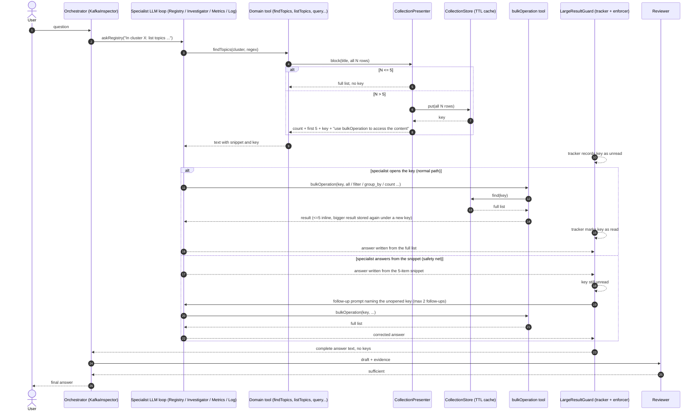

# Large collections: how tools, specialists and the orchestrator handle them

No tool hands a long list to an LLM. A result of more than 5 items is stored server-side, and the
LLM gets the count, the first 5 items and a **collection key**. The specialist then works on the
full list through the `bulkOperation` tool. The orchestrator never sees a key: it receives the
specialist's finished answer.

## Flow

## Components

| Component | Module / package | Role |
|---|---|---|
| `CollectionPresenter` | `kafkatower-common`, `collections` | Used by every list-returning tool. `block` / `inline` show up to 5 items; above that it stores the list and prints count, snippet, key and an `INCOMPLETE` notice. `completeBlock` prints every item (used by `all`). |
| `CollectionStore` | same | Caffeine cache. TTL `agent.collections.ttl-seconds` (600), bounded by total items `agent.collections.max-items` (200000). |
| `BulkCollectionTools` (`bulkOperation`) | `kafkatower-common`, `tools` | Applies one operation to a stored list. A result of more than 5 items is stored again under a new key. |
| `BulkOperation` implementations | `collections.bulk` | `count`, `slice`, `all`, `chunk`, `filter`, `exclude`, `filter_number`, `sort`, `distinct`, `group_by`, `map`, `flat_map`, `aggregate`. |
| `LargeResultGuard` | `collections` | The single entry point a specialist calls instead of `createObject`. Adds `bulkOperation`, the result limiter and the tracker to the specialist's `PromptRunner`, then runs the enforcer. The only place the collections feature touches the Embabel runner. |
| `UnreadCollectionTracker` (package-private) | `collections` | Per request, a `ToolCallInspector`. Records keys printed by tools, marks a key read when `bulkOperation` is called with it. Sees results before the limiter cuts them, so a key is never lost to truncation. |
| `FullListEnforcer` (package-private) | `collections` | Unread keys left after an answer cause a follow-up prompt naming them, at most 2 times. |
| `ToolResultLimiter` | `kafkatower-common`, `utils` | A `ToolLoopTransformer`. Caps any tool result at 8,000 characters with advice on narrowing the request (per-tool advice via `ToolTruncationAdvice` beans, e.g. `PromQlTruncationAdvice`), and replaces an empty result with a placeholder. Applies to every tool on the runner. |
| `CachedTools` / `ToolResultCache` | `kafkatower-common`, `utils` | Builds the tools of an `@LlmTool` object, serving the `@CachedTool` ones from a short-TTL single-flight cache (`agent.cache.tools.*`). Offered with `withTools(cachedTools.from(obj))`. The cache holds raw results; truncation happens afterwards. |

## Where it applies

- **Converted tools:** Kafka admin tools, registry tools, OpenSearch `search_documents` and
  `aggregate_documents`, PromQL `metrics`, `query`, `query_range`, `labels`, `label_values`.
- **Specialists** (Registry, Investigator, Metrics, Log): call `LargeResultGuard.answer`, which gives
  them `bulkOperation`, the limiter, the tracker and the enforcer, plus the shared guidance
  `skills/shared/LARGE_RESULTS.md`.
- **Orchestrator and reviewer:** unchanged. The orchestrator's own `listClusters` still returns an
  unbounded list.

## `bulkOperation` operations

| Operation | `expression` | `parameter` |
|---|---|---|
| `count` | | |
| `slice` | start offset (default 0) | number of items (default 5) |
| `all` | | |
| `chunk` | items per chunk | |
| `filter`, `exclude` | Java regex | |
| `filter_number` | regex with one capture group around a number | `gt` / `gte` / `lt` / `lte` / `eq` / `ne` plus a value, e.g. `gt 1000` |
| `sort` | optional regex whose first group is the sort key | `asc` (default) or `desc` |
| `distinct` | | |
| `group_by` | regex; first group (or the whole match) is the group name | |
| `map` | Java regex | replacement, e.g. `$1` |
| `flat_map` | delimiter regex | |
| `aggregate` | regex with one capture group around a number | `sum`, `min`, `max` or `avg` |

## Limits

- Only an opened key counts as read. A specialist that opens a list with `count` and then answers
  satisfies the check.
- Keys printed by `bulkOperation` itself are not tracked. A specialist that filters to 20 items and
  answers from the snippet is not caught.
- `all` refuses collections larger than `agent.collections.max-full-items` (500). The 8,000
  character cut-off on tool output (`ToolResultLimiter`) still applies.
- Each follow-up from the enforcer costs one more LLM call.
- A key expires after the TTL. An expired key tells the model to call the original tool again.

## Configuration

| Property | Default | Meaning |
|---|---|---|
| `agent.collections.inline-limit` | 5 | Items shown before a list is stored |
| `agent.collections.ttl-seconds` | 600 | Lifetime of a stored list |
| `agent.collections.max-items` | 200000 | Total items held across all stored lists |
| `agent.collections.max-full-items` | 500 | Largest list `all` returns |
